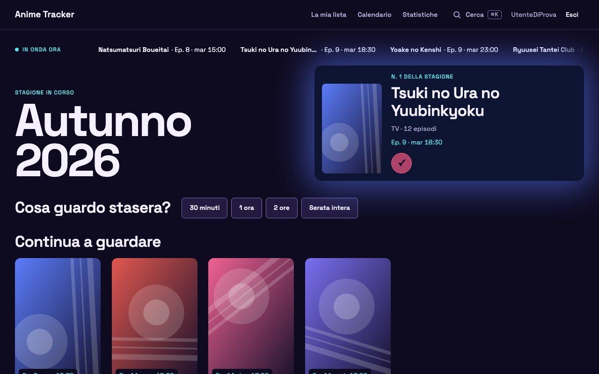
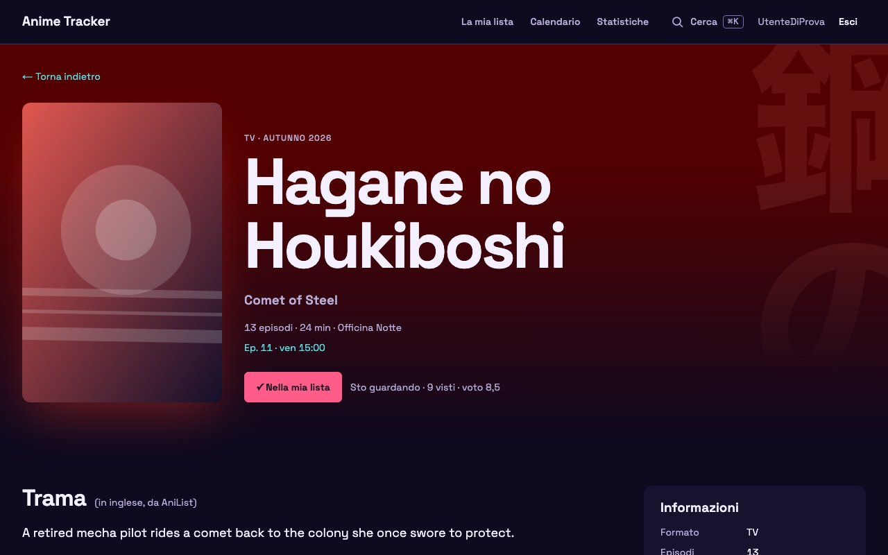
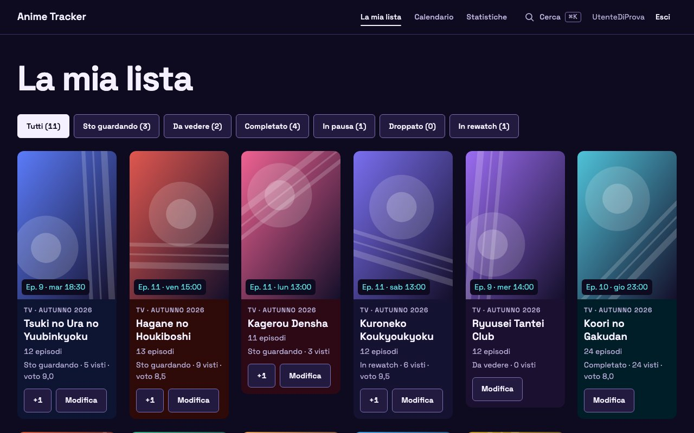
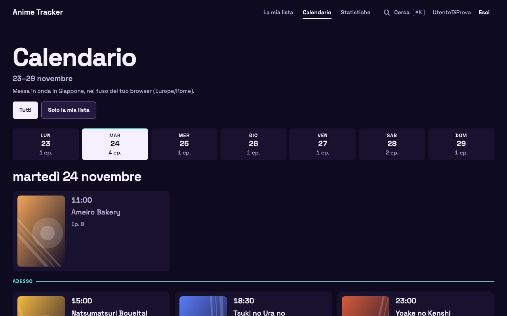
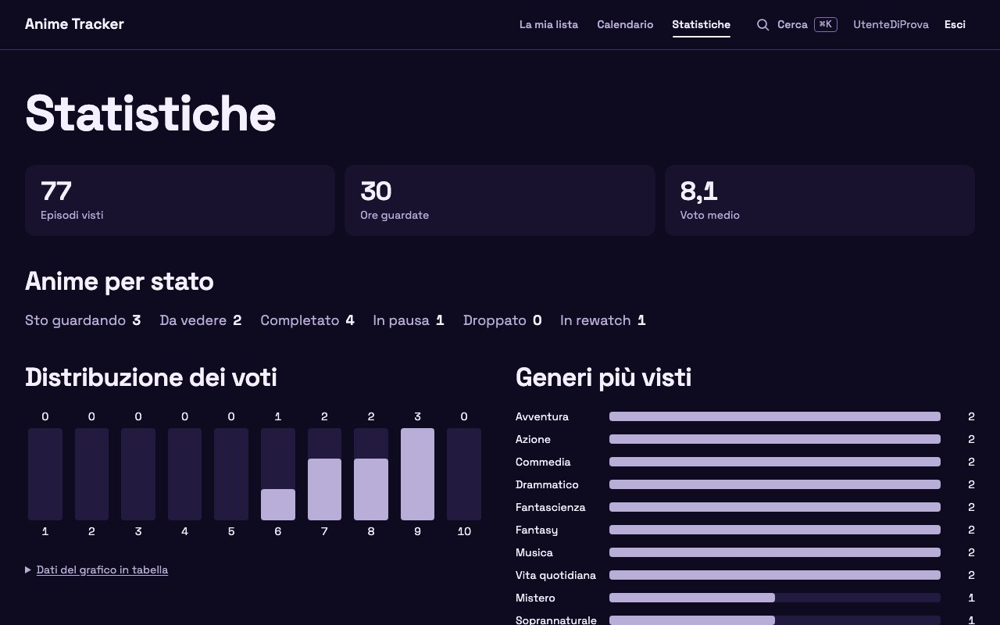
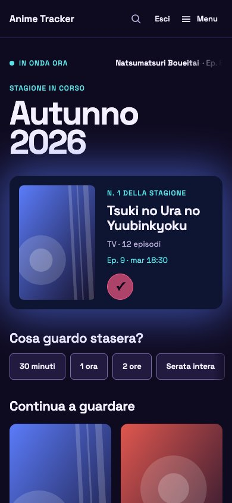

# Anime Tracker

**Provalo online: [anime-tracker-three.vercel.app](https://anime-tracker-three.vercel.app)**, il modo migliore per vedere l'app. Senza account si usano Home, Ricerca, Dettaglio, Calendario e, in sola lettura, la lista di un profilo dimostrativo; con un account AniList si segue e si modifica la propria lista.

Client non ufficiale e complementare di [AniList](https://anilist.co) per seguire i propri anime, basato sulla sua [API GraphQL](https://docs.anilist.co/). È un progetto-esercizio per il portfolio, non un prodotto: conta la qualità dell'esecuzione (codice, interfaccia, accessibilità, documentazione), non il numero di funzioni. Interfaccia in italiano.



| | |
|---|---|
|  |  |
|  |  |



Gli screenshot usano i dati inventati del finto AniList dei test (`npm run screenshots`): titoli, trame e studi sono inventati, le copertine sono disegni generati. Le copertine vere si caricano solo dagli indirizzi di AniList e non entrano nel repository.

## Cosa fa

- **Home:** gli anime della stagione in corso, il più popolare in evidenza; la striscia "In onda ora" con gli episodi delle prossime 24 ore; per chi è collegato, "Continua a guardare" (episodi usciti e non ancora visti) e "Cosa guardo stasera?" (2–3 proposte dalla propria lista per il tempo che si ha, ognuna con il motivo).
- **Ricerca:** una pagina e una ricerca rapida in sovrimpressione (⌘K / Ctrl+K), con i titoli in romaji, in inglese e alcuni titoli italiani.
- **Dettaglio:** trama, generi, studi, prossimi episodi nel fuso del browser, e la voce della propria lista da aggiungere o modificare. La copertina passa dalla card al Dettaglio con una View Transition e torna nella card con Indietro.
- **La mia lista:** la lista di AniList con i filtri per stato e per voto, "+1" per gli episodi visti, modifica di stato, episodi, voto e note.
- **Calendario:** la settimana un giorno alla volta, gli orari nel fuso del browser, il filtro "Solo la mia lista".
- **Statistiche:** episodi e ore guardate, voto medio, anime per stato, distribuzione dei voti, generi e studi più presenti.

## Decisioni principali

Le decisioni sono registrate negli ADR, con contesto, alternative e motivazioni.

- **La lista vive su AniList** ([ADR-0004](docs/adr/0004-client-anilist-con-login.md)). I termini d'uso di AniList vietano i tracker concorrenti e l'uso dell'API come archivio: l'app mostra e modifica la lista dell'account AniList, senza database e senza copie locali (niente `localStorage`, niente cache persistente). Il login è OAuth con AniList, gestito dal server Next.js: il token resta in un cookie `__Host-` `HttpOnly` e non arriva mai al JavaScript della pagina, agli indirizzi o ai log. Le modifiche passano da Route Handler che controllano l'`Origin`.
- **Richieste ad AniList, cache e limiti** ([ADR-0003](docs/adr/0003-dati-cache-rate-limit.md)). AniList concede poche richieste al minuto, contate per indirizzo IP, quindi tutte le visite condividono un solo limite. I dati uguali per tutti (stagione, Dettaglio, Calendario, lista demo) si leggono sul server con la cache di `fetch` di Next.js, che sopravvive ai deploy: molte visite costano una richiesta per finestra di aggiornamento. Dal browser partono solo la Ricerca e le parti personali, con al massimo un nuovo tentativo, mai polling. Un 429 mostra quanto aspettare e lascia i dati che ci sono. `robots.txt` chiede ai crawler di non entrare: una cortesia, la protezione vera resta la cache.
- **Accessibilità** (WCAG 2.2 AA, [DESIGN](docs/DESIGN.md)). Ogni pagina passa i controlli di axe nei test end-to-end, anche a 360px e con il login. Tutto si usa da tastiera, con il focus gestito dove la pagina cambia: dialoghi modali, card che escono dalla lista, ritorno dal Dettaglio. Le regioni `role="status"` annunciano i risultati, i bersagli sono di almeno 44×44px e ogni pagina sta in 320px senza scorrere di lato. Con `prefers-reduced-motion` restano solo dissolvenze brevi.
- **Stack** ([ADR-0001](docs/adr/0001-stack.md)): Next.js 16 (App Router), React 19, TypeScript, Tailwind CSS v4, TanStack Query, GraphQL Codegen sullo schema ufficiale di AniList, Vitest, Playwright con axe. Le animazioni usano solo strumenti del browser (View Transitions, Web Animations, CSS), senza librerie.

## Come avviarlo

Serve Node 22.

```bash
npm ci
cp .env.example .env.local   # poi i valori di un'applicazione AniList di sviluppo
npm run dev                  # http://localhost:3000
```

Le variabili d'ambiente sono solo lato server: `ANILIST_CLIENT_ID`, `ANILIST_CLIENT_SECRET` e `ANILIST_REDIRECT_URI` per il login (da [anilist.co/settings/developer](https://anilist.co/settings/developer)), `ANILIST_DEMO_USERNAME` per la lista dimostrativa. Senza i valori del login, il login è spento e il resto funziona.

| Comando | Cosa fa |
|---|---|
| `npm run lint` | ESLint |
| `npm run typecheck` | Tipi delle route e di GraphQL, poi `tsc --noEmit` |
| `npm test` | Test unitari con Vitest |
| `npm run test:e2e` | Test end-to-end con Playwright e axe, su un finto AniList locale: nessuna richiesta al vero AniList (`npx playwright install --only-shell chromium` la prima volta) |
| `npm run screenshots` | Gli screenshot di questo README, dai dati della vetrina del finto AniList |
| `npm run check:secret` | Controlla che il client secret di `.env.local` non sia nei file del repository né nella cronologia |

## Documentazione

- [Specifica](docs/SPEC.md): cosa fa l'app, schermata per schermata.
- [Design](docs/DESIGN.md): colori, tipografia, componenti, effetti, accessibilità e budget di prestazioni.
- [Milestone](docs/MILESTONES.md): il piano di lavoro, da M0 a M8, con le decisioni prese lungo la strada.
- Decisioni: [ADR-0001](docs/adr/0001-stack.md) stack, [ADR-0002](docs/adr/0002-lista-nel-browser.md) lista nel browser (sostituito), [ADR-0003](docs/adr/0003-dati-cache-rate-limit.md) richieste, cache e limiti, [ADR-0004](docs/adr/0004-client-anilist-con-login.md) client complementare con login.

---

Anime Tracker è un client non ufficiale per AniList, non affiliato ad AniList. Dati forniti da [AniList](https://anilist.co). Nessun uso commerciale: niente pubblicità, pagamenti o raccolta di dati degli utenti.
